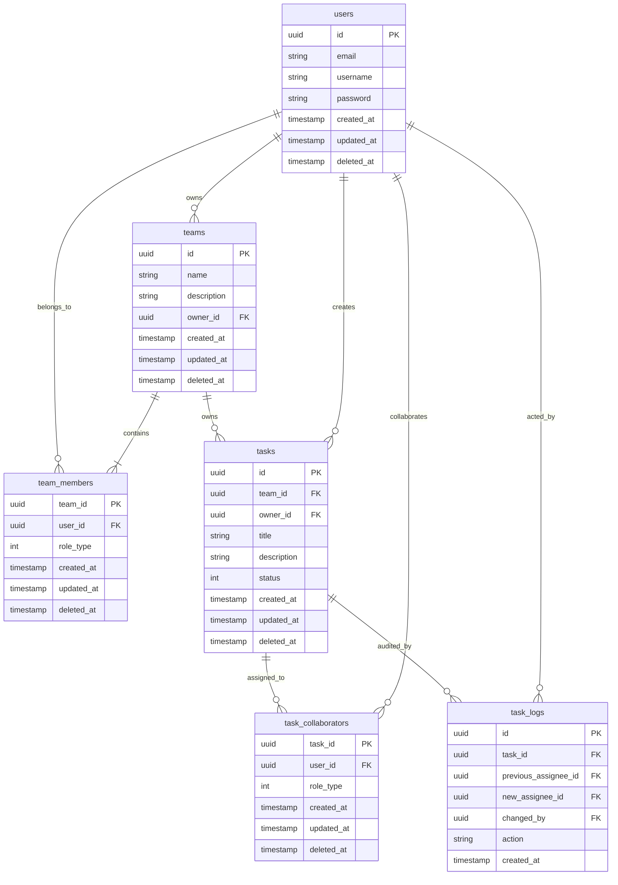
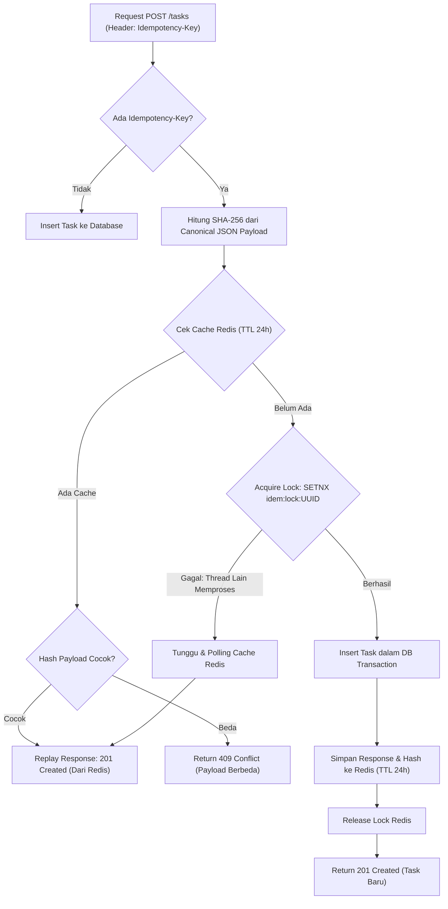
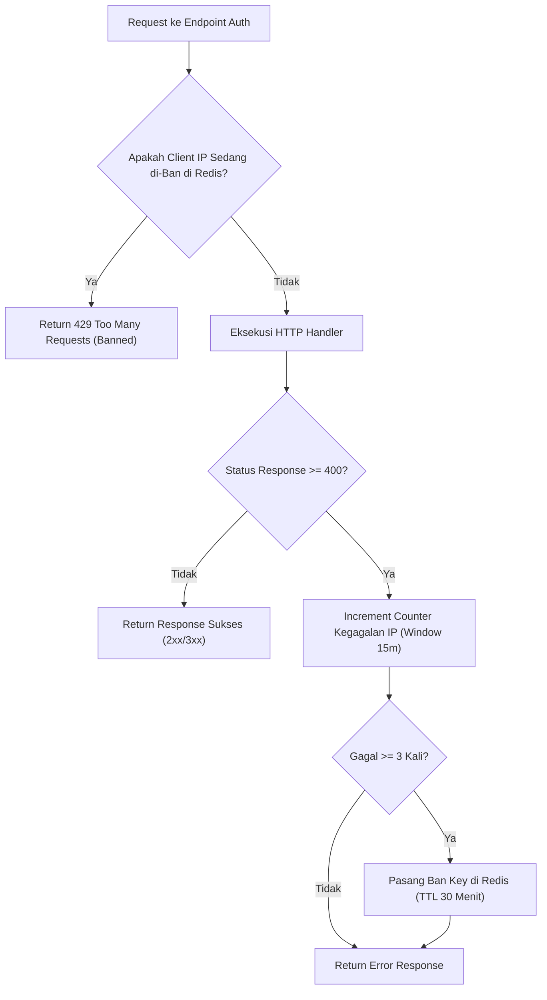
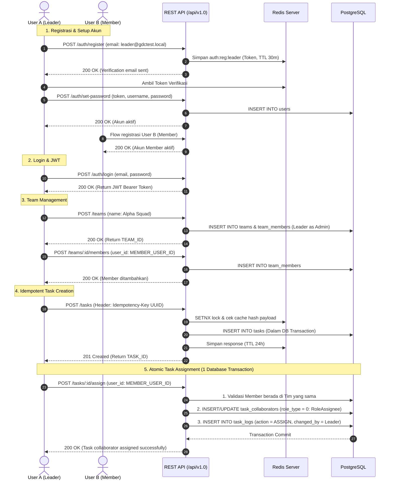

# Technical Test — Back End Developer Service (`gdctest`)

Layanan RESTful API backend berbasis Go (Golang) yang dibangun dengan arsitektur modular (*Clean Architecture*), mendukung autentikasi JWT, manajemen tim (*Team Management*), task management dengan idempotency berbasis hash payload dan Redis lock, serta integritas transaksi database atomik untuk delegasi tugas (*task assignment*) beserta pencatatan audit log.

---

## 1. How to Run

### Prerequisites
- [Go 1.22+](https://go.dev/dl/)
- [Docker & Docker Compose](https://www.docker.com/)
- `curl` / Postman untuk pengujian HTTP

---

### A. Menjalankan via Docker Compose (Rekomendasi)
Seluruh dependensi (PostgreSQL 16, Redis 7, Mailpit SMTP, dan Go application service) telah dikonfigurasi dalam `docker-compose.yml`:

```bash
# 1. Jalankan seluruh container di background
docker compose up -d --build

# 2. Cek status container
docker compose ps
```

Container yang akan aktif:
- **Application (`gdctest-app`)**: `http://localhost:8080`
- **PostgreSQL (`gdctest-postgres`)**: `localhost:5432` (`postgres:postgres`, DB: `gdctest`)
- **Redis (`gdctest-redis`)**: `localhost:6379`
- **Mailpit Web UI (`gdctest-mailpit`)**: `http://localhost:8025` (SMTP port: `1025`)

---

### B. Menjalankan Aplikasi Secara Lokal (Development)

1. Jalankan dependensi database dan Redis via docker compose:
   ```bash
   docker compose up -d postgres redis mailpit
   ```

2. Jalankan database migration:
   ```bash
   docker exec -i gdctest-postgres psql -U postgres -d gdctest < database/migrations/000001_init_schema.up.sql
   docker exec -i gdctest-postgres psql -U postgres -d gdctest < database/migrations/000002_create_teams_and_link_tasks.up.sql
   docker exec -i gdctest-postgres psql -U postgres -d gdctest < database/migrations/000003_add_task_logs_and_assignee.up.sql
   ```

3. Jalankan aplikasi Go:
   ```bash
   go run ./app rest
   ```

---

### C. Menjalankan Pengujian (Testing)

- **Unit Test Suite (Mock-based, tanpa dependensi eksternal)**:
  ```bash
  go test -v ./...
  ```
- **Manual End-to-End API Test Scripts (via bash & curl)**:
  ```bash
  # Pengujian Auth Domain (Register, Redis Token, Login, Reset, Blacklist, Rate Limiting)
  bash scripts/manual_auth_test.sh

  # Pengujian Task & Team Domain (Team, Idempotency 201/409, Query Filter, DB Transaction Assign)
  bash scripts/manual_task_team_test.sh
  ```

---

## 2. Database Schema & ERD Design

Arsitektur database dirancang ternormalisasi dengan integritas referensial kuat (*foreign keys*), *soft delete* (`deleted_at`), serta pemisahan relasi kolaborator dan audit log tugas:

### Entity Relationship Diagram (ERD)



### Penjelasan Kunci Desain Skema:
1. **Pemisahan Assignee & Multi-Collaborator**:
   Alih-alih menambahkan kolom `assignee_id` statis di tabel `tasks` (yang membatasi task hanya memiliki 1 orang atau redundan saat role bertambah), sistem menggunakan tabel relasi `task_collaborators` dengan `role_type = 0` (*RoleAssignee*).
2. **Audit Trail `task_logs`**:
   Mencatat riwayat mutasi delegasi tugas (`action = 'ASSIGN'`), user yang melakukan perubahan (`changed_by`), penugasan sebelumnya (`previous_assignee_id`), dan penugasan baru (`new_assignee_id`).
3. **Database Indexing Teroptimasi**:
   - `idx_tasks_team_status_created` pada `(team_id, status, created_at DESC)` untuk pagination & filtering cepat.
   - `idx_tasks_title_lower` pada `LOWER(title)` untuk pencarian *case-insensitive*.
   - `idx_task_collaborators_assignee` berupa *partial index* `WHERE role_type = 0`.

---

## 3. Implementasi Idempotency & Rate Limiter

### A. Idempotency (`POST /tasks`)

Fitur idempotensi menjamin bahwa pengulangan request pembuatan task dengan key yang sama tidak akan menduplikasi data di database, serta kebal terhadap *concurrent race conditions*.



#### Mekanisme Detail:
1. **Payload Hashing**: Payload request diserialisasi secara deterministik (*canonical JSON*) lalu di-hash dengan **SHA-256**.
2. **Atomic Concurrency Lock (`SETNX`)**:
   Untuk mencegah *race condition* jika ada $N$ request identik masuk di milidetik yang sama, thread pertama mengambil lock atomik `SET idem:lock:<KEY> NX EX 10s`. Request paralel lainnya tidak akan men-duplikasi query insert ke database, melainkan menunggu (*polling loop*) hingga thread pertama selesai dan mengambil hasil dari cache Redis.
3. **Penyimpanan Redis (TTL 24 Jam)**:
   Response task yang sukses disimpan di Redis dengan key `idem:task:<KEY>` selama 24 jam.
4. **Deteksi Konflik (`409 Conflict`)**:
   Jika request berikutnya datang dengan `Idempotency-Key` yang sama tetapi isian datanya berbeda (hash payload tidak cocok), sistem menolak dengan HTTP `409 Conflict`.

---

### B. Rate Limiter & Failure IP Banning

Sistem menerapkan rate limiting bertingkat menggunakan Redis untuk melindungi endpoint kritis dari serangan *brute force* dan *credential stuffing*:



#### Komponen Rate Limiter:
1. **Registration Rate Limit**:
   Membatasi maksimal 3 permintaan pendaftaran per alamat email dalam kurun waktu 30 menit.
2. **Failure Rate Limit Middleware (`middleware.FailureRateLimit`)**:
   - Ditempelkan pada endpoint autentikasi (`/login`, `/register`, `/set-password`, `/reset-password`).
   - Melacak jumlah kegagalan (response status $\ge 400$) berdasarkan kombinasi `Path + Real IP` menggunakan jendela geser (*sliding window*) 15 menit.
   - Jika terjadi **3 kali kegagalan berturut-turut**, IP tersebut otomatis di-ban selama **30 menit** di Redis (`ratelimit:ban:fail:<path>:<ip>`).
   - Setiap request yang masuk saat masa ban akan langsung ditolak dengan respon `429 Too Many Requests` disertai durasi ban tersisa.

---

## 4. User Journey: Dari Registrasi hingga Assignment Task ke Member

Alur kerja lengkap dari pendaftaran pengguna baru, pembentukan tim, pembuatan task idempotens, hingga delegasi tugas:



---

## 5. Dokumentasi API Detail & Postman Import

Postman Collection v2.1.0 telah disediakan dan dapat langsung diimpor ke aplikasi Postman:
- **File Postman Collection**: [`docs/postman_auth_collection.json`](file:///home/dwikky/GolandProjects/gdctest/docs/postman_auth_collection.json)

### Cara Import ke Postman:
1. Buka aplikasi **Postman**.
2. Klik tombol **Import** (di pojok kiri atas).
3. Pilih file [`docs/postman_auth_collection.json`](file:///home/dwikky/GolandProjects/gdctest/docs/postman_auth_collection.json).
4. Atur Environment Variables di Postman:
   - `base_url`: `http://localhost:8080`
   - `jwt_token`: *(otomatis terisi saat menjalankan request Login)*
   - `team_id`: *(ID tim yang dibuat)*
   - `task_id`: *(ID task yang dibuat)*

---

### Ringkasan Endpoint API

#### A. Authentication Module (`/api/v1.0/auth`)

| No | Method | Endpoint | Auth | Request Body | Status Sukses | Deskripsi |
|---|---|---|:---:|---|:---:|---|
| 1 | `POST` | `/auth/register` | No | `{"email": "string"}` | `200 OK` | Mengirim tautan pendaftaran ke email & simpan token di Redis |
| 2 | `POST` | `/auth/set-password` | No | `{"token": "...", "username": "...", "password": "..."}` | `200 OK` | Verifikasi token dan simpan pengguna baru ke PostgreSQL |
| 3 | `POST` | `/auth/login` | No | `{"email": "...", "password": "..."}` | `200 OK` | Login dan menghasilkan JWT Bearer Token |
| 4 | `POST` | `/auth/forgot-password`| No | `{"email": "..."}` | `200 OK` | Permintaan reset password, simpan token di Redis |
| 5 | `POST` | `/auth/reset-password` | No | `{"token": "...", "password": "..."}` | `200 OK` | Reset password dan invalidasi seluruh sesi user |
| 6 | `POST` | `/auth/logout` | Bearer | *-* | `200 OK` | Blacklist token JWT aktif ke Redis |
| 7 | `GET` | `/auth/users` | Bearer | *-* | `200 OK` | Mendapatkan daftar pengguna terdaftar (paginated) |

#### B. Team Module (`/api/v1.0/teams`)

| No | Method | Endpoint | Auth | Request Body | Status Sukses | Deskripsi |
|---|---|---|:---:|---|:---:|---|
| 8 | `POST` | `/teams` | Bearer | `{"name": "...", "description": "..."}` | `200 OK` | Membuat tim baru (pembuat otomatis jadi Admin) |
| 9 | `GET` | `/teams` | Bearer | *-* | `200 OK` | Mendapatkan daftar tim pengguna |
| 10 | `POST` | `/teams/:id/members` | Bearer | `{"user_id": "UUID"}` | `200 OK` | Menambahkan anggota baru ke tim |
| 11 | `GET` | `/teams/:id/members` | Bearer | *-* | `200 OK` | Mendapatkan daftar anggota tim |
| 12 | `DELETE`| `/teams/:id/members/:uid`| Bearer | *-* | `200 OK` | Soft delete anggota dari tim |
| 13 | `DELETE`| `/teams/:id` | Bearer | *-* | `200 OK` | Menghapus tim (hanya dapat dilakukan oleh Owner) |

#### C. Task Module (`/api/v1.0/tasks`)

| No | Method | Endpoint | Auth | Header Khusus | Request Body | Status Sukses | Deskripsi |
|---|---|---|:---:|:---:|---|:---:|---|
| 14 | `POST` | `/tasks` | Bearer | `Idempotency-Key: <UUID>` | `{"team_id": "...", "title": "...", "description": "..."}` | `201 Created` | Membuat task baru dengan proteksi idempotensi |
| 15 | `GET` | `/tasks` | Bearer | *-* | *(Query Params)* `?team_id=...&status=0&title=...&page=1&limit=10` | `200 OK` | Pencarian, filtering status, dan pagination task |
| 16 | `GET` | `/tasks/:id` | Bearer | *-* | *-* | `200 OK` | Mendapatkan detail task |
| 17 | `PUT` | `/tasks/:id` | Bearer | *-* | `{"title": "...", "status": 1}` | `200 OK` | Mengubah task (judul, deskripsi, status) |
| 18 | `POST` | `/tasks/:id/assign` | Bearer | *-* | `{"user_id": "UUID"}` | `200 OK` | Transaksi atomik penugasan anggota + pencatatan `task_logs` |
| 19 | `DELETE`| `/tasks/:id` | Bearer | *-* | *-* | `200 OK` | Menghapus task |

---

## 6. Format Standar Structured Response & Error

Seluruh endpoint API mengembalikan format JSON konsisten:

```json
{
  "status": true,
  "message": "Successful",
  "data": { ... },
  "timestamp": "2026-10-14T06:18:29Z"
}
```

Format respon error (`4xx` / `5xx`):
```json
{
  "status": false,
  "code": "BAD_REQUEST",
  "message": "Bad Request. user_id is required",
  "error": "user_id is required",
  "timestamp": "2026-10-14T06:18:29Z"
}
```
Stack trace atau detail error internal database di-*masking* dari respon client untuk mencegah *data leakage*.
